# Linie automată de îmbuteliere — program structurat (TIA Portal / S7-1500)
### Automated bottling line — structured program (TIA Portal / S7-1500)

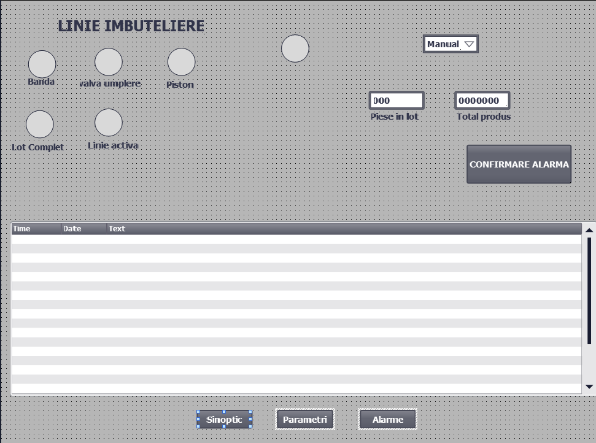

**🌐 Limbă / Language:** [Română](#-română) · [English](#-english)

---

## 🇷🇴 Română

- [Descriere](#descriere)
- [Fluxul procesului](#fluxul-procesului)
- [Arhitectura programului](#arhitectura-programului)
- [Variabile (I/O)](#variabile-io)
- [Cum funcționează](#cum-funcționează)
- [Panoul de operator (HMI)](#panoul-de-operator-hmi)
- [Logica programului](#logica-programului)
- [Concepte demonstrate](#concepte-demonstrate)
- [Stare curentă și limitări](#stare-curentă-și-limitări)
- [Cum se rulează](#cum-se-rulează)
- [Realizat cu](#realizat-cu)

### Descriere

Sistem de comandă pentru o linie de îmbuteliere, implementat în Ladder (LAD) pentru SIMATIC S7-1500, cu panou de operator în WinCC RT Advanced.

Proiectul este rescrierea unei aplicații realizate inițial în CODESYS, unde toată logica era într-un singur program liniar. Aici, aceeași funcționalitate este reorganizată după practicile folosite în proiectele industriale: logica este împărțită în blocuri funcționale cu responsabilitate unică, parametrii de proces sunt scoși din cod în blocuri de date editabile din HMI, iar alarmele sunt colectate într-un cuvânt de stare în loc de variabile booleene separate.

Scopul rescrierii nu a fost adăugarea de funcții noi, ci învățarea structurii: ce câștigi și ce plătești când treci de la cod liniar la cod modular.

### Fluxul procesului

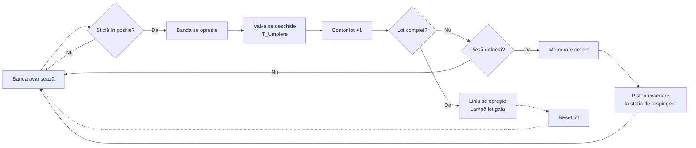

În paralel cu secvența principală rulează două funcții de supraveghere: un watchdog pe stația de umplere, care declanșează alarma de blocaj dacă umplerea nu se termină în timpul alocat, și stratul de siguranță, care retrage toate permisiunile la apăsarea opririi de urgență sau la apariția oricărei alarme.

### Arhitectura programului

Programul este împărțit în șase blocuri funcționale, fiecare cu propriul DB de instanță, apelate în ordine strictă din `Main [OB1]`.

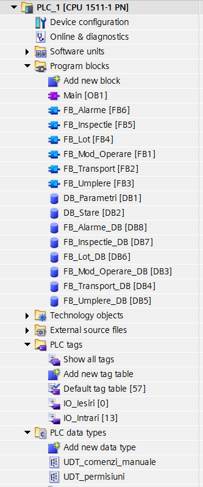

| Bloc | Rol |
|---|---|
| `FB_Mod_Operare` [FB1] | Evaluează o singură dată condițiile globale (urgență, alarme, selector, start/stop) și produce setul de permisiuni |
| `FB_Transport` [FB2] | Comanda benzii, cu interblocajele de proces |
| `FB_Umplere` [FB3] | Valva, temporizarea umplerii și watchdog-ul de blocaj |
| `FB_Lot` [FB4] | Contorul de piese pe lot și contorul general de producție |
| `FB_Inspectie` [FB5] | Memoria piesei defecte și comanda pistonului de evacuare |
| `FB_Alarme` [FB6] | Colectează alarmele în cuvântul de stare citit de HMI |

Ordinea apelurilor nu este arbitrară. Fiecare bloc consumă rezultate produse de cele dinaintea lui, în același ciclu de scanare; singura excepție este cuvântul de alarme, care circulă cu un ciclu întârziere, pentru că `FB_Alarme` este apelat ultimul.

Două blocuri de date globale separă clar setările de rezultate:

| DB | Cine scrie | Cine citește | Conținut |
|---|---|---|---|
| `DB_Parametri` [DB1] | HMI | PLC | Timpi și praguri de proces, toate cu `Retain` |
| `DB_Stare` [DB2] | PLC | HMI | Starea liniei, contoare, cuvântul de alarme |

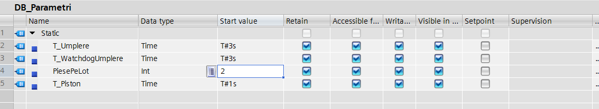
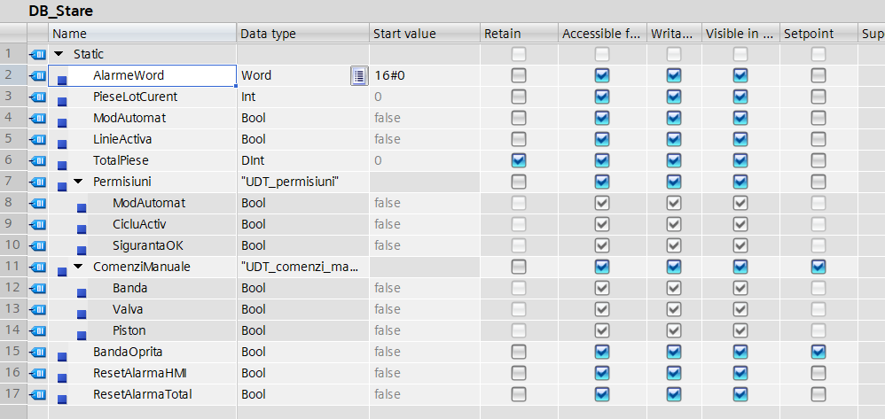

Două tipuri de date definite de utilizator grupează semnalele care circulă între blocuri, astfel încât o intrare nouă să nu ceară modificarea interfeței fiecărui bloc:

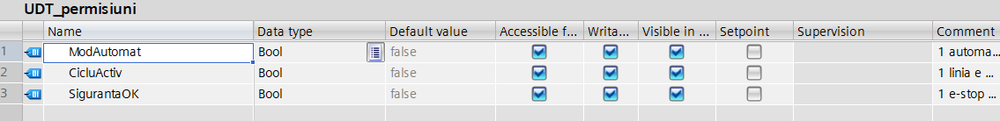
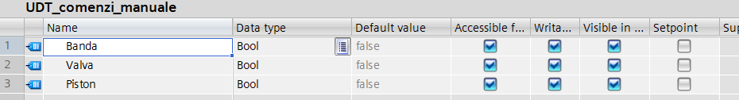

### Variabile (I/O)

Denumirea urmează schema uzuală în documentația Siemens: `S` buton sau selector, `B` senzor, `M` motor, `V` valvă, `K` actuator pneumatic, `H` lampă.

**Intrări**

| Variabilă | Adresă | Rol |
|---|---|---|
| `S01_Start` | `%I0.0` | Pornire ciclu, contact NO |
| `S02_Stop` | `%I0.1` | Oprire ciclu |
| `S03_EStop` | `%I0.2` | Oprire de urgență |
| `S04_ModAuto` | `%I0.3` | Selector regim: 1 = automat |
| `S05_ResetAlarma` | `%I0.4` | Confirmare alarmă |
| `S06_ResetLot` | `%I0.5` | Resetare contor lot |
| `B01_PrezentaSticla` | `%I0.6` | Senzor poziție umplere |
| `B02_Calitate` | `%I0.7` | Senzor inspecție, 1 = piesă defectă |
| `B03_Respingere` | `%I1.0` | Senzor poziție evacuare |
| `S10_ManBanda` | `%I1.1` | Comandă manuală bandă |
| `S11_ManValva` | `%I1.2` | Comandă manuală valvă |
| `S12_ManPiston` | `%I1.3` | Comandă manuală piston |
| `Clock_2Hz` | `%M0.5` | Bit de clock din CPU, pentru lampa intermitentă |

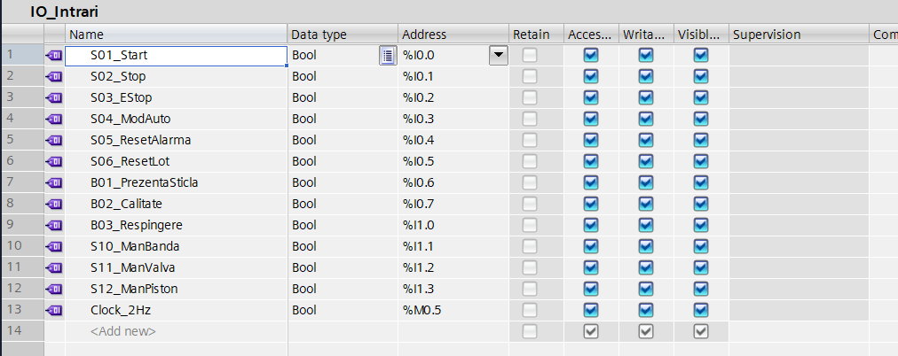

**Ieșiri**

| Variabilă | Adresă | Rol |
|---|---|---|
| `M01_Banda` | `%Q0.0` | Motor bandă transport |
| `V01_Umplere` | `%Q0.1` | Electrovalvă umplere |
| `K01_Piston` | `%Q0.2` | Piston evacuare defecte |
| `H01_LotGata` | `%Q0.3` | Lampă lot complet |
| `H02_Alarma` | `%Q0.4` | Lampă alarmă, intermitentă |

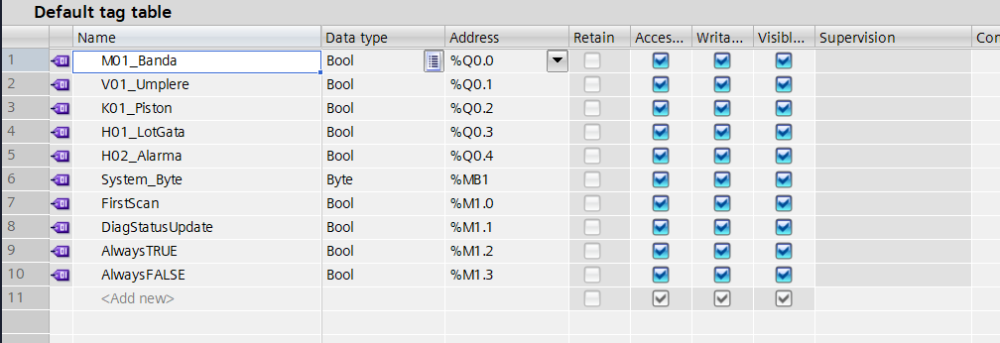

**Parametri de proces** — `DB_Parametri`, editabili din HMI

| Variabilă | Tip | Valoare inițială | Rol |
|---|---|---|---|
| `T_Umplere` | `Time` | `T#3s` | Durata deschiderii valvei |
| `T_WatchdogUmplere` | `Time` | `T#3s` | Timeout pentru alarma de blocaj |
| `PiesePeLot` | `Int` | `2` | Număr de sticle pe lot |
| `T_Piston` | `Time` | `T#1s` | Durata acționării pistonului |

**Stare și memorii interne** — `DB_Stare`

| Variabilă | Tip | Rol |
|---|---|---|
| `AlarmeWord` | `Word` | Cuvânt de alarme, un bit per alarmă |
| `PieseLotCurent` | `Int` | Sticle umplute în lotul curent |
| `TotalPiese` | `DInt` | Contor general, `Retain` |
| `ModAutomat`, `LinieActiva` | `Bool` | Stare pentru HMI |
| `Permisiuni` | `UDT_permisiuni` | `ModAutomat`, `CicluActiv`, `SigurantaOK` |
| `ComenziManuale` | `UDT_comenzi_manuale` | `Banda`, `Valva`, `Piston` |
| `BandaOprita` | `Bool` | Negația comenzii de bandă |
| `ResetAlarmaHMI`, `ResetAlarmaTotal` | `Bool` | Confirmare alarmă din două surse |

**Alocarea biților din `AlarmeWord`**

| Bit | Alarmă |
|---|---|
| 0 | Blocaj la umplere — timeout |
| 1 | Oprire de urgență apăsată |
| 2…15 | Rezervat |

### Cum funcționează

**Permisiunile.** În varianta CODESYS, contactele de urgență, de selector și de alarmă se repetau în aproape fiecare rețea. Aici condițiile se evaluează o singură dată în `FB_Mod_Operare`, iar rezultatul circulă ca structură. `SigurantaOK` este adevărat când urgența nu e apăsată **și** cuvântul de alarme este zero — o singură comparație acoperă toate cele 16 alarme posibile, indiferent câte sunt definite.

**Regimul automat și manual.** Fiecare ieșire are o singură bobină, alimentată din două ramuri paralele: calea automată, condiționată de `CicluActiv` și `ModAutomat`, și calea manuală, condiționată de negația lui `ModAutomat` și de comanda de pe buton. Cele două ramuri se închid înaintea condițiilor de siguranță și a interblocajelor de proces, astfel încât acestea rămân active în ambele regimuri. Nu există comandă manuală care să ocolească urgența sau să deschidă valva în timp ce banda se mișcă.

**Umplerea.** Valva stă deschisă cât timp temporizatorul `T_Doza` nu a expirat. Limitarea de timp este pe linia principală, după punctul de închidere al ramurii manuale, deci valva se închide singură chiar dacă operatorul ține butonul apăsat — protecție împotriva revărsării.

**Watchdog-ul.** Dacă o sticlă este în poziție, ciclul e activ, dar umplerea nu s-a încheiat în `T_WatchdogUmplere`, temporizatorul `T_Alarma` expiră și setează alarma de blocaj. Alarma este latch-uită în `FB_Umplere` și cade doar la confirmare — blocul care detectează este și cel care memorează, iar `FB_Alarme` doar raportează.

**Urmărirea piesei defecte.** Senzorul de calitate vede defectul la o stație, pistonul lovește la alta. Memoria se setează cu bobină `S` la detecție și se resetează cu bobină `R` pe **frontul descendent** al senzorului de respingere, detectat cu contactul `-|N|-`. Pe frontul crescător memoria ar cădea exact în momentul în care pistonul ar trebui să acționeze; pe frontul descendent, memoria persistă până când piesa a trecut complet.

**Contoarele.** Lotul este numărat cu `CTU_INT`, care are prag și ieșire de comparație. Contorul general nu folosește `CTU`: un `Int` se rostogolește la 32.767, ceea ce pe o linie reală se întâmplă în câteva zile de funcționare continuă. Se incrementează un `DInt` cu `ADD`, condiționat de un contact de front pozitiv.

### Panoul de operator (HMI)

Trei ecrane, navigabile dintr-o bară comună poziționată identic pe fiecare.

**Sinoptic** — starea liniei în timp real: lămpi pentru bandă, valvă, piston, lot complet și linie activă, contorul de lot și totalul produs, indicatorul de regim și lista de alarme active.

**Parametri** — cele trei câmpuri în care operatorul scrie. Sunt singurele legături de scriere din tot panoul.

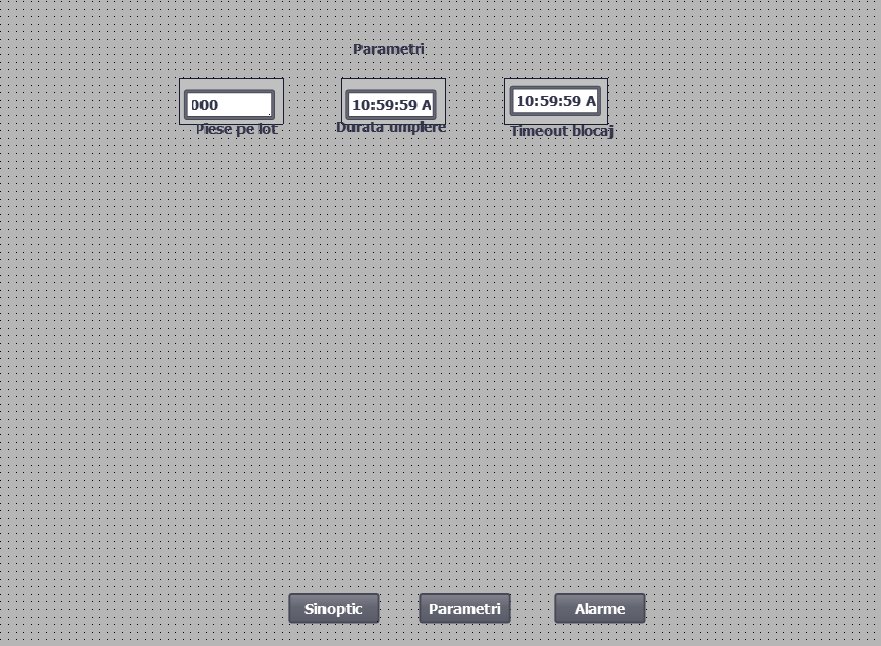

**Alarme** — istoricul complet, pe tot ecranul.

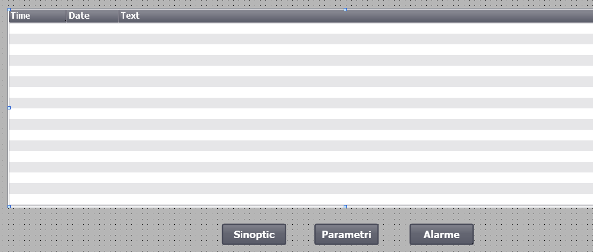

Alarmele sunt configurate ca `Discrete alarms` pe cuvântul `AlarmeWord`: fiecare rând leagă un bit la un text. HMI-ul citește o singură variabilă și se ocupă singur de afișare, marcaj de timp, confirmare și istoric.

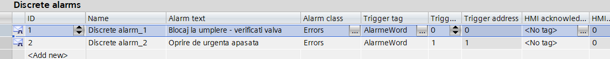
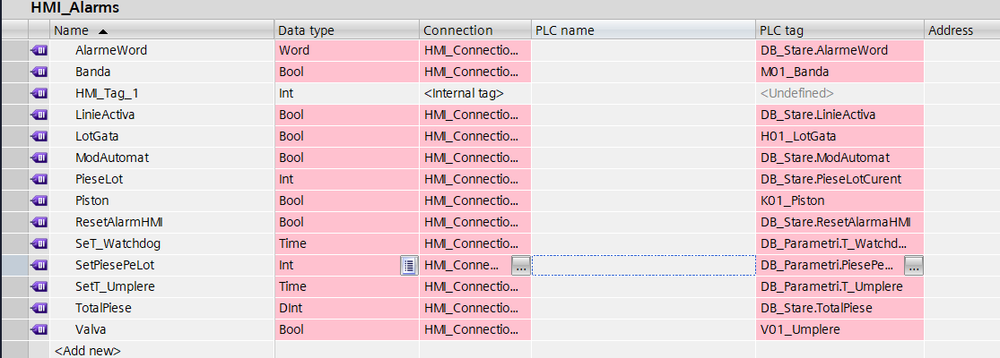

Principiul respectat peste tot: **zero logică în HMI**. Panoul citește și scrie variabile, nimic altceva. Confirmarea alarmei de pe ecran nu acționează direct asupra logicii, ci scrie într-o variabilă proprie, combinată în PLC cu butonul fizic printr-un SAU — același tipar folosit pentru orice comandă cu două surse.

Oprirea de urgență rămâne buton fizic cablat. Nu apare ca buton pe HMI și nu trebuie să apară.

### Logica programului

Interfețele celor șase blocuri:

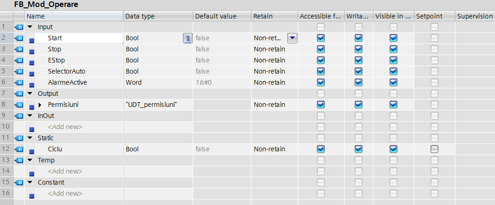
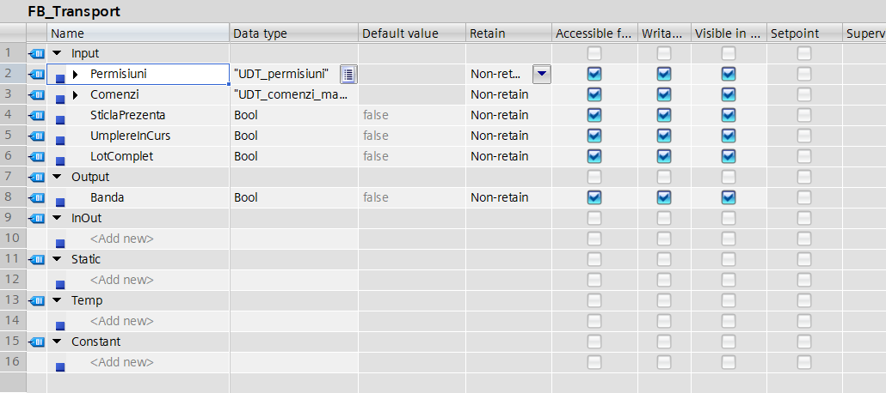
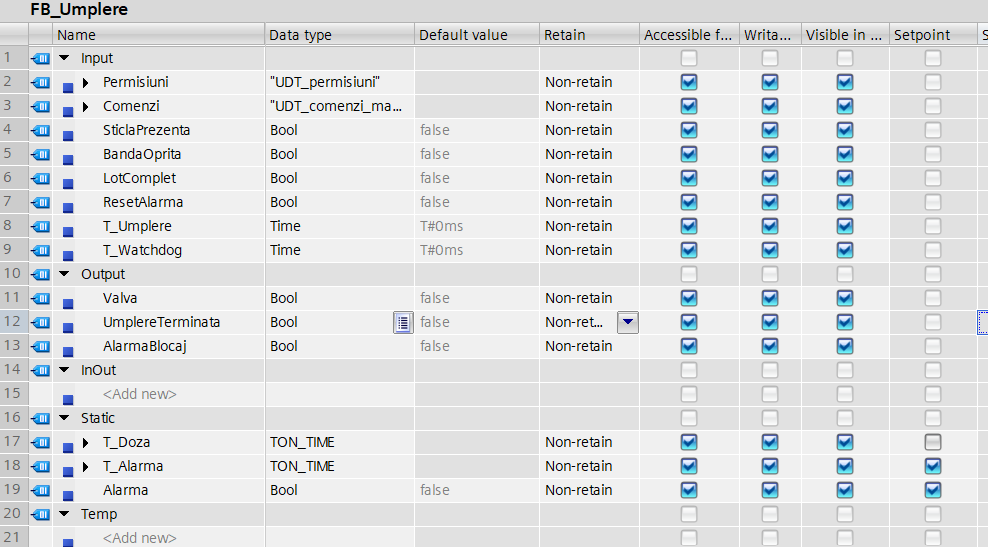
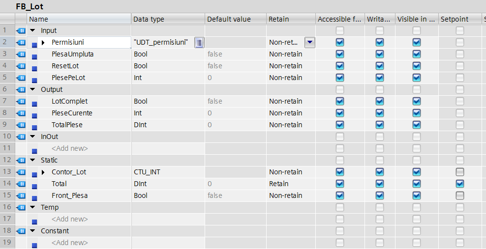
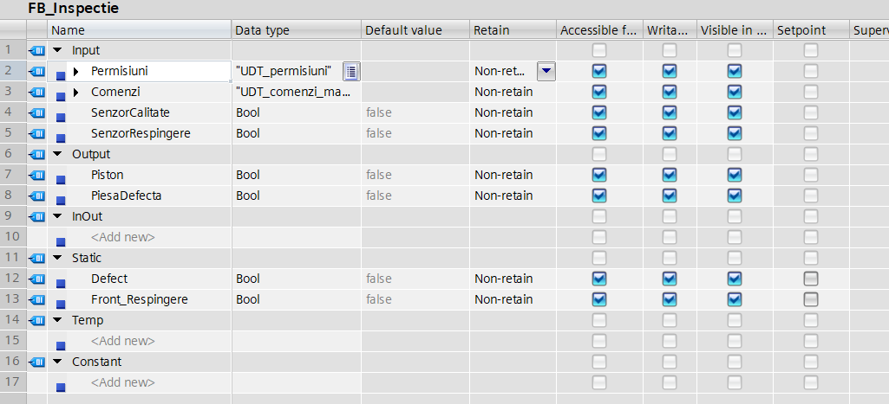
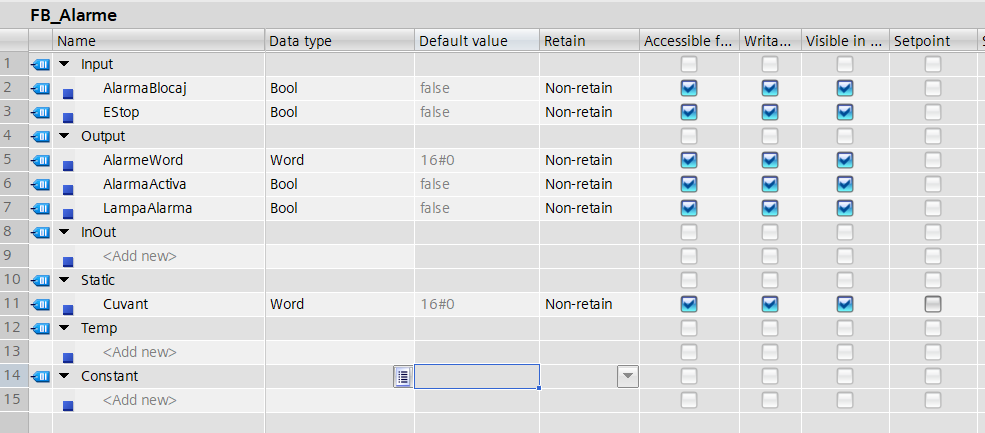

Asamblarea în `Main [OB1]` — paisprezece rețele, din care șase sunt apelurile blocurilor, iar restul copiază comenzile manuale în structură și pregătesc variabilele pentru HMI:

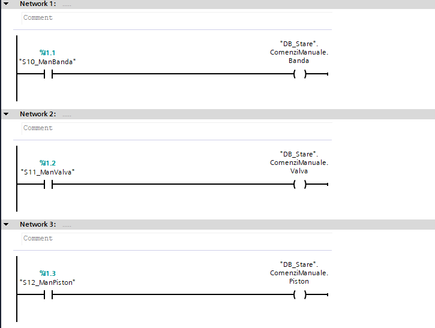
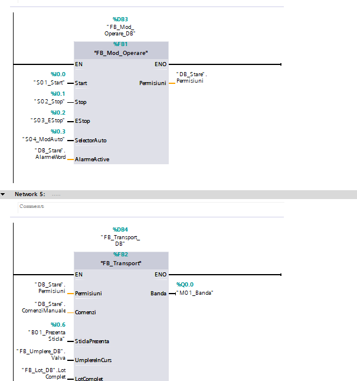
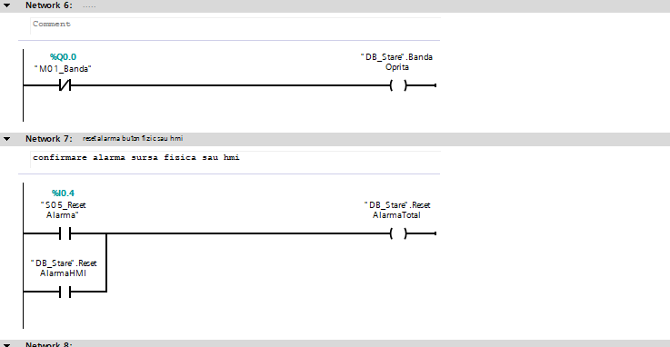
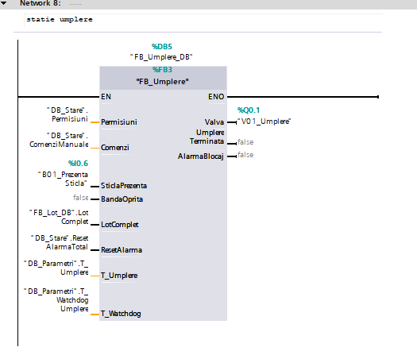
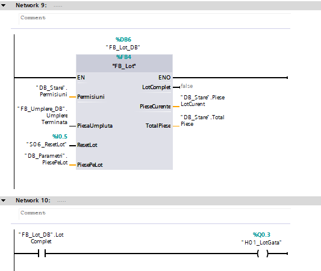
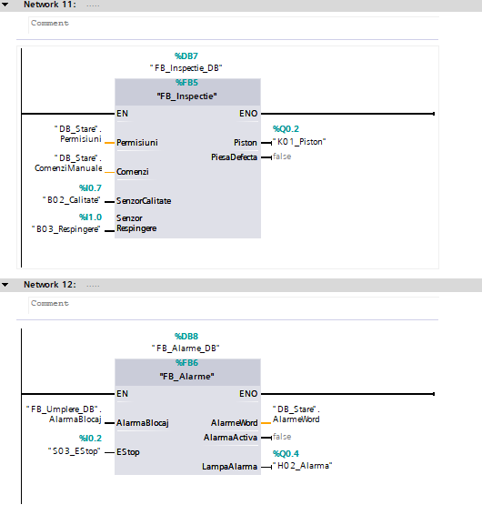
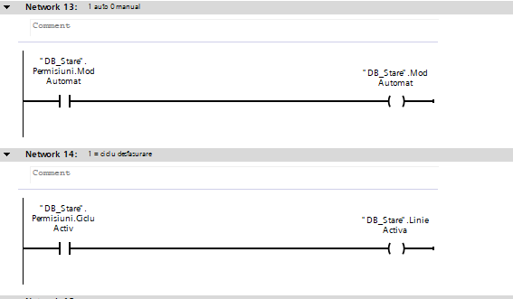

### Concepte demonstrate

- Program structurat pe blocuri funcționale cu responsabilitate unică, apelate în ordine determinată de fluxul de date
- DB de instanță per bloc, cu acces din exterior la ieșirile blocului
- Separarea parametrilor de rețetă de starea procesului, în blocuri de date distincte, cu `Retain` acolo unde pierderea valorii ar deranja operatorul
- Tipuri de date definite de utilizator pentru semnalele care circulă între blocuri
- Alarme pe biți într-un cuvânt de stare, cu alocare documentată
- Comandă din două surse pe aceeași ieșire, cu o singură bobină
- Interblocaje de proces active în ambele regimuri de operare
- Detecție de front pozitiv și negativ, cu bit de memorie în `Static`
- Alegerea tipului întreg după valoarea maximă realistă: `Int` pentru lot, `DInt` pentru totalul de producție
- Biții de clock din CPU pentru semnalizare intermitentă
- Numerotare și denumire a semnalelor după convenția din documentația Siemens

### Stare curentă și limitări

Proiectul a fost scris și compilat, dar **nu a fost rulat**. Simulatorul S7-PLCSIM nu a fost disponibil: se descarcă separat de TIA Portal și este supus controlului de export, iar autorizarea nu a fost obținută. Partea PLC compilează fără erori și fără avertismente; validarea comportamentului rămâne de făcut.

Puncte deschise:

- Pinul `BandaOprita` al lui `FB_Umplere` este lăsat la valoarea implicită `false`, deși rețeaua care calculează semnalul există în OB1. Până la legarea lui, valva nu se deschide în regim automat.
- Cele două câmpuri de timp din ecranul `Parametri` sunt legate direct la variabile de tip `Time`, pe care un câmp I/O numeric nu le acceptă. Soluția este o pereche de variabile `DInt` în `DB_Parametri`, convertite în `Time` cu instrucțiunea `CONV` înainte de apelul blocului de umplere.
- Reglarea nivelului cu `PID_Compact` nu face parte din acest proiect.

### Cum se rulează

1. Deschide proiectul în TIA Portal V20 sau mai nou, cu STEP 7 Professional.
2. Compilează hardware-ul și software-ul: click dreapta pe `PLC_1` → `Compile` → `Hardware and software (only changes)`.
3. Pentru simulare este necesar S7-PLCSIM instalat separat. Cu el disponibil: selectează `PLC_1` → `Start simulation` → `Load`.
4. Forțează semnalele de intrare dintr-un `Watch and force table` sau din tabela SIM a simulatorului.
5. Pentru panou: selectează `HMI_RT_1` → `Start simulation`.

Stația PC trebuie să aibă modulul `IE general` în rack și o conexiune HMI configurată între cele două dispozitive în `Devices & networks`:

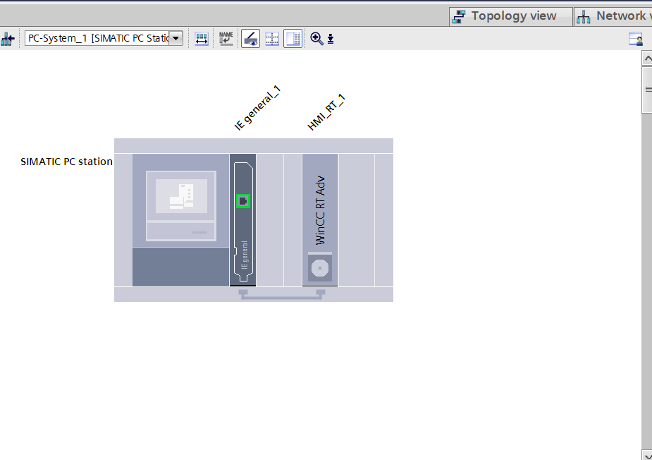

### Realizat cu

- TIA Portal V20, STEP 7 Professional
- SIMATIC S7-1500, CPU 1511-1 PN
- WinCC RT Advanced V20
- Limbaj: Ladder (LAD), conform IEC 61131-3

---

## 🇬🇧 English

- [Overview](#overview)
- [Process flow](#process-flow)
- [Program architecture](#program-architecture)
- [Variables (I/O)](#variables-io)
- [How it works](#how-it-works)
- [Operator panel (HMI)](#operator-panel-hmi)
- [Program logic](#program-logic)
- [Concepts demonstrated](#concepts-demonstrated)
- [Current state and limitations](#current-state-and-limitations)
- [How to run](#how-to-run)
- [Built with](#built-with)

### Overview

Control system for a bottling line, implemented in Ladder (LAD) for SIMATIC S7-1500, with an operator panel in WinCC RT Advanced.

The project is a rewrite of an application originally built in CODESYS, where all the logic lived in a single linear program. Here the same functionality is reorganised along the lines used in industrial projects: the logic is split into function blocks with a single responsibility, process parameters are lifted out of the code into data blocks the operator can edit from the HMI, and alarms are gathered into a status word instead of separate boolean variables.

The point of the rewrite was not new features but structure: what you gain and what you pay when you move from linear code to modular code.

### Process flow

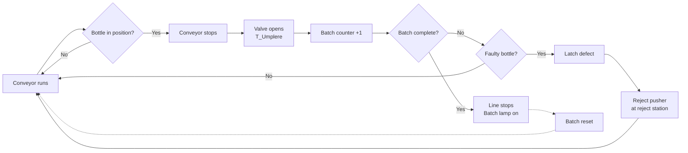

Two supervisory functions run alongside the main sequence: a watchdog on the filling station, which raises the jam alarm if filling does not finish within the allotted time, and the safety layer, which withdraws every permission when the emergency stop is pressed or any alarm appears.

### Program architecture

The program is split into six function blocks, each with its own instance DB, called in a fixed order from `Main [OB1]`.

| Block | Role |
|---|---|
| `FB_Mod_Operare` [FB1] | Evaluates the global conditions once (e-stop, alarms, selector, start/stop) and produces the permission set |
| `FB_Transport` [FB2] | Conveyor command, with the process interlocks |
| `FB_Umplere` [FB3] | Valve, fill timing and jam watchdog |
| `FB_Lot` [FB4] | Batch counter and lifetime production counter |
| `FB_Inspectie` [FB5] | Defect latch and reject pusher command |
| `FB_Alarme` [FB6] | Collects alarms into the status word the HMI reads |

The call order is not arbitrary. Each block consumes results produced by the ones before it, within the same scan cycle; the only exception is the alarm word, which travels with a one-cycle delay because `FB_Alarme` is called last.

Two global data blocks keep settings and results clearly apart:

| DB | Written by | Read by | Contents |
|---|---|---|---|
| `DB_Parametri` [DB1] | HMI | PLC | Process times and thresholds, all `Retain` |
| `DB_Stare` [DB2] | PLC | HMI | Line state, counters, alarm word |

Two user-defined types group the signals that travel between blocks, so that a new input does not force a change to every block interface:

### Variables (I/O)

Naming follows the scheme common in Siemens documentation: `S` pushbutton or selector, `B` sensor, `M` motor, `V` valve, `K` pneumatic actuator, `H` lamp.

**Inputs**

| Variable | Address | Role |
|---|---|---|
| `S01_Start` | `%I0.0` | Cycle start, NO contact |
| `S02_Stop` | `%I0.1` | Cycle stop |
| `S03_EStop` | `%I0.2` | Emergency stop |
| `S04_ModAuto` | `%I0.3` | Mode selector: 1 = automatic |
| `S05_ResetAlarma` | `%I0.4` | Alarm acknowledge |
| `S06_ResetLot` | `%I0.5` | Batch counter reset |
| `B01_PrezentaSticla` | `%I0.6` | Fill position sensor |
| `B02_Calitate` | `%I0.7` | Inspection sensor, 1 = faulty |
| `B03_Respingere` | `%I1.0` | Reject position sensor |
| `S10_ManBanda` | `%I1.1` | Manual conveyor command |
| `S11_ManValva` | `%I1.2` | Manual valve command |
| `S12_ManPiston` | `%I1.3` | Manual pusher command |
| `Clock_2Hz` | `%M0.5` | CPU clock bit, drives the flashing lamp |

**Outputs**

| Variable | Address | Role |
|---|---|---|
| `M01_Banda` | `%Q0.0` | Conveyor motor |
| `V01_Umplere` | `%Q0.1` | Fill solenoid valve |
| `K01_Piston` | `%Q0.2` | Reject pusher |
| `H01_LotGata` | `%Q0.3` | Batch complete lamp |
| `H02_Alarma` | `%Q0.4` | Alarm lamp, flashing |

**Process parameters** — `DB_Parametri`, editable from the HMI

| Variable | Type | Start value | Role |
|---|---|---|---|
| `T_Umplere` | `Time` | `T#3s` | How long the valve stays open |
| `T_WatchdogUmplere` | `Time` | `T#3s` | Jam alarm timeout |
| `PiesePeLot` | `Int` | `2` | Bottles per batch |
| `T_Piston` | `Time` | `T#1s` | Pusher stroke duration |

**State and internal memory** — `DB_Stare`

| Variable | Type | Role |
|---|---|---|
| `AlarmeWord` | `Word` | Alarm word, one bit per alarm |
| `PieseLotCurent` | `Int` | Bottles filled in the current batch |
| `TotalPiese` | `DInt` | Lifetime counter, `Retain` |
| `ModAutomat`, `LinieActiva` | `Bool` | State for the HMI |
| `Permisiuni` | `UDT_permisiuni` | `ModAutomat`, `CicluActiv`, `SigurantaOK` |
| `ComenziManuale` | `UDT_comenzi_manuale` | `Banda`, `Valva`, `Piston` |
| `BandaOprita` | `Bool` | Negation of the conveyor command |
| `ResetAlarmaHMI`, `ResetAlarmaTotal` | `Bool` | Alarm acknowledge from two sources |

**`AlarmeWord` bit allocation**

| Bit | Alarm |
|---|---|
| 0 | Jam at filling — timeout |
| 1 | Emergency stop pressed |
| 2…15 | Reserved |

### How it works

**Permissions.** In the CODESYS version, the e-stop, selector and alarm contacts repeated in almost every rung. Here the conditions are evaluated once in `FB_Mod_Operare` and the result travels as a structure. `SigurantaOK` is true when the e-stop is not pressed **and** the alarm word is zero — a single comparison covers all 16 possible alarms, however many are actually defined.

**Automatic and manual modes.** Each output has one coil, fed by two parallel branches: the automatic path, gated by `CicluActiv` and `ModAutomat`, and the manual path, gated by the negation of `ModAutomat` and the pushbutton. The two branches close before the safety conditions and the process interlocks, so those stay active in both modes. No manual command can bypass the e-stop or open the valve while the conveyor is moving.

**Filling.** The valve stays open while the `T_Doza` timer has not expired. The time limit sits on the main rung, after the manual branch closes, so the valve shuts by itself even if the operator holds the button down — overflow protection.

**The watchdog.** If a bottle is in position, the cycle is active, but filling has not finished within `T_WatchdogUmplere`, the `T_Alarma` timer expires and sets the jam alarm. The alarm is latched inside `FB_Umplere` and clears only on acknowledge — the block that detects is also the block that remembers, and `FB_Alarme` merely reports.

**Tracking a faulty bottle.** The quality sensor sees the defect at one station, the pusher strikes at another. The latch is set with an `S` coil on detection and cleared with an `R` coil on the **falling edge** of the reject sensor, detected with the `-|N|-` contact. On the rising edge the latch would drop exactly when the pusher should fire; on the falling edge it persists until the bottle has fully passed.

**The counters.** The batch is counted with `CTU_INT`, which gives a preset and a comparison output. The lifetime counter does not use `CTU`: an `Int` rolls over at 32,767, which on a real line happens within a few days of continuous running. A `DInt` is incremented with `ADD`, gated by a rising-edge contact.

### Operator panel (HMI)

Three screens, navigated from a common bar placed identically on each.

**Synoptic** — live line state: lamps for conveyor, valve, pusher, batch complete and line active, the batch counter and lifetime total, the mode indicator and the active alarm list.

**Parameters** — the three fields the operator writes to. They are the only write bindings in the whole panel.

**Alarms** — the full history, full screen.

Alarms are configured as `Discrete alarms` on the `AlarmeWord` word: each row ties a bit to a text. The HMI reads a single variable and handles display, timestamping, acknowledgement and history on its own.

The principle held throughout: **no logic in the HMI**. The panel reads and writes variables, nothing more. Acknowledging an alarm from the screen does not act on the logic directly; it writes to its own variable, combined in the PLC with the physical button through an OR — the same pattern used for any two-source command.

The emergency stop stays a hardwired physical button. It does not appear on the HMI, and it should not.

### Program logic

The six block interfaces:

Assembly in `Main [OB1]` — fourteen rungs, six of which are the block calls, the rest copying manual commands into the structure and preparing variables for the HMI:

### Concepts demonstrated

- Structured program built from single-responsibility function blocks, called in an order dictated by the data flow
- One instance DB per block, with the block outputs readable from outside
- Recipe parameters kept apart from process state, in separate data blocks, with `Retain` where losing a value would inconvenience the operator
- User-defined types for the signals that travel between blocks
- Bit-mapped alarms in a status word, with a documented allocation
- Two-source command on one output, driven by a single coil
- Process interlocks active in both operating modes
- Rising- and falling-edge detection, with the memory bit declared in `Static`
- Integer type chosen by realistic maximum: `Int` for the batch, `DInt` for lifetime production
- CPU clock bits for flashing indication
- Signal naming and numbering following the convention used in Siemens documentation

### Current state and limitations

The project was written and compiled, but **never executed**. The S7-PLCSIM simulator was not available: it downloads separately from TIA Portal and is export-controlled, and the authorisation was not obtained. The PLC side compiles with no errors and no warnings; behavioural validation remains to be done.

Open points:

- The `BandaOprita` pin of `FB_Umplere` is left at its default `false`, although the rung that computes the signal exists in OB1. Until it is wired, the valve will not open in automatic mode.
- The two time fields on the `Parametri` screen are bound directly to `Time` variables, which a numeric I/O field does not accept. The fix is a pair of `DInt` variables in `DB_Parametri`, converted to `Time` with the `CONV` instruction before the filling block is called.
- Level control with `PID_Compact` is not part of this project.

### How to run

1. Open the project in TIA Portal V20 or newer, with STEP 7 Professional.
2. Compile hardware and software: right-click `PLC_1` → `Compile` → `Hardware and software (only changes)`.
3. Simulation requires S7-PLCSIM, installed separately. With it available: select `PLC_1` → `Start simulation` → `Load`.
4. Force the input signals from a `Watch and force table` or from the simulator's SIM table.
5. For the panel: select `HMI_RT_1` → `Start simulation`.

The PC station needs an `IE general` module in the rack and an HMI connection configured between the two devices in `Devices & networks`:

### Built with

- TIA Portal V20, STEP 7 Professional
- SIMATIC S7-1500, CPU 1511-1 PN
- WinCC RT Advanced V20
- Language: Ladder (LAD), per IEC 61131-3
