# Rezervor cu măsurare analogică de nivel (TIA Portal / S7-1500)
### Tank with analog level measurement (TIA Portal / S7-1500)

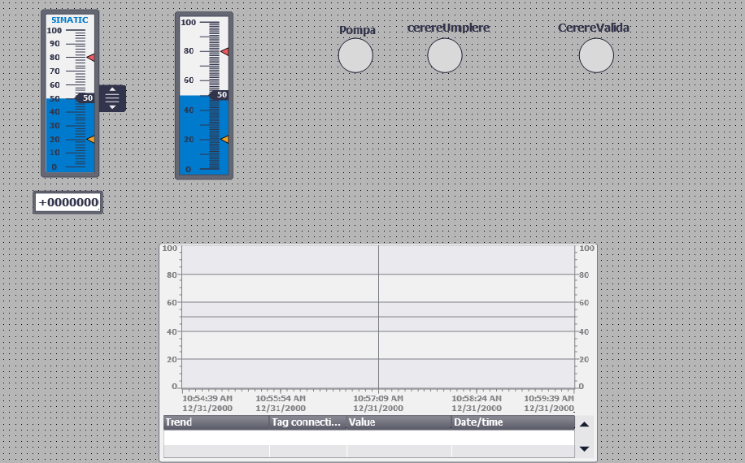

**🌐 Limbă / Language:** [Română](#-română) · [English](#-english)

---

## 🇷🇴 Română

- [Descriere](#descriere)
- [Lanțul semnalului](#lanțul-semnalului)
- [Configurația hardware](#configurația-hardware)
- [Arhitectura programului](#arhitectura-programului)
- [Variabile (I/O)](#variabile-io)
- [Cum funcționează](#cum-funcționează)
- [Panoul de operator (HMI)](#panoul-de-operator-hmi)
- [Logica programului](#logica-programului)
- [Concepte demonstrate](#concepte-demonstrate)
- [Stare curentă și limitări](#stare-curentă-și-limitări)
- [Cum se rulează](#cum-se-rulează)
- [Realizat cu](#realizat-cu)

### Descriere

Sistem de comandă pentru un rezervor cu nivel măsurat analogic, implementat în Ladder (LAD) pentru SIMATIC S7-1500, cu panou de operator în WinCC RT Advanced.

Un traductor de nivel 4–20 mA este citit printr-un modul de intrări analogice și convertit în procente. Pe baza nivelului, programul comandă o pompă de umplere cu histerezis între două praguri, supraveghează plauzibilitatea semnalului, ridică alarme de nivel și comandă o valvă proporțională de golire printr-un modul de ieșiri analogice.

Proiectul completează linia de îmbuteliere din același portofoliu, care lucra exclusiv cu semnale digitale. Aici accentul cade pe ce aduce în plus un semnal analogic: conversia între valoarea brută și unitățile inginerești în ambele sensuri, compararea numerelor reale, histerezisul și, mai ales, faptul că o măsurătoare trebuie validată înainte de a fi folosită.

### Lanțul semnalului

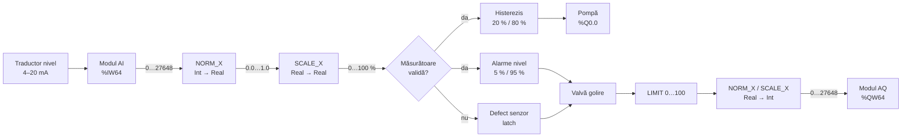

### Configurația hardware

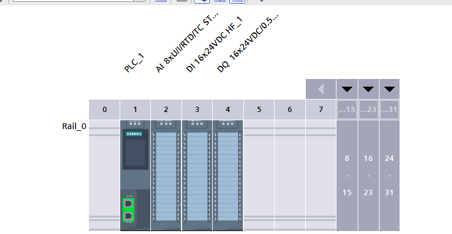

| Slot | Modul | Articol | Adrese |
|---|---|---|---|
| 1 | CPU 1511-1 PN | `6ES7 511-1AL03-0AB0` | — |
| 2 | AI 8xU/I/RTD/TC ST | `6ES7 531-7KF00-0AB0` | `%IW64…%IW78` |
| 3 | DI 16x24VDC HF | `6ES7 521-1BH00-0AB0` | `%I0.0…%I1.7` |
| 4 | DQ 16x24VDC/0.5A HF | `6ES7 522-1BH00-0AB0` | `%Q0.0…%Q1.7` |
| 5 | AQ 4xU/I ST | `6ES7 532-5HD00-0AB0` | `%QW64…%QW70` |

Canalul 0 al modulului analogic de intrare este parametrizat manual pe `Current (2-wire transducer)`, domeniul `4..20 mA`, cu filtrare `Weak` și diagnoza de fir rupt activată. Netezirea semnalului se face astfel în hardware, fără nicio linie de cod.

Adresele analogice încep intenționat de la 64, separat de cele digitale. Când cineva citește o adresă într-o schemă electrică sau într-un raport de diagnoză, știe imediat ce fel de semnal este, fără să deschidă configurația.

### Arhitectura programului

Patru blocuri funcționale, apelate din `Main [OB1]` într-o ordine dictată de fluxul de date.

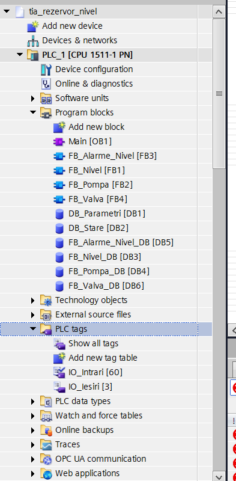

| Bloc | Rol |
|---|---|
| `FB_Nivel` [FB1] | Convertește valoarea brută a traductorului în procente |
| `FB_Alarme_Nivel` [FB3] | Validează semnalul, detectează defectul de senzor, ridică alarmele de nivel |
| `FB_Pompa` [FB2] | Comandă pompa cu histerezis, în regim automat sau manual |
| `FB_Valva` [FB4] | Comandă valva proporțională, cu priorități de siguranță și limitare |

Ordinea apelurilor este `FB_Nivel` → `FB_Alarme_Nivel` → `FB_Pompa` → `FB_Valva`. Pompa are nevoie de nivelul și de validarea calculate în același ciclu, iar valva are nevoie de alarma de nivel ridicat.

Două blocuri de date globale separă setările de rezultate:

| DB | Cine scrie | Cine citește | Conținut |
|---|---|---|---|
| `DB_Parametri` [DB1] | HMI | PLC | Scala, pragurile de histerezis și de alarmă, deschiderea valvei — toate `Retain` |
| `DB_Stare` [DB2] | PLC | HMI | Nivelul în procente, cererea de umplere, cuvântul de alarme, validarea măsurătorii |

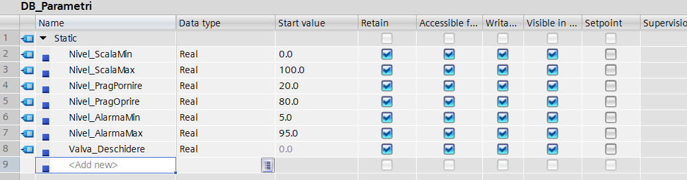
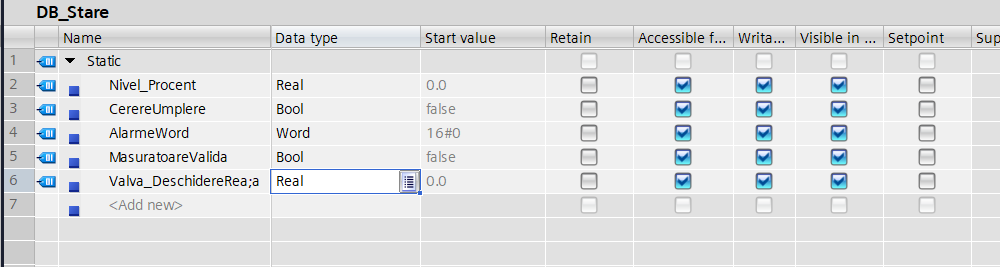

### Variabile (I/O)

**Intrări**

| Variabilă | Tip | Adresă | Rol |
|---|---|---|---|
| `B01_NivelBrut` | `Int` | `%IW64` | Traductor de nivel, valoare brută |
| `S01_ModAuto` | `Bool` | `%I1.0` | Selector regim: 1 = automat |
| `S02_ManPompa` | `Bool` | `%I1.1` | Comandă manuală pompă |
| `S03_ResetAlarma` | `Bool` | `%I1.2` | Confirmare alarmă |
| `Clock_2Hz` | `Bool` | `%M0.5` | Bit de clock din CPU, pentru lampa intermitentă |

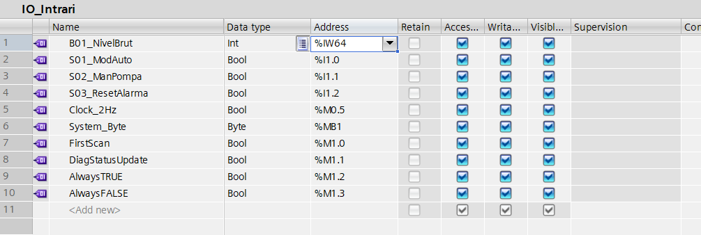

**Ieșiri**

| Variabilă | Tip | Adresă | Rol |
|---|---|---|---|
| `P01_Pompa` | `Bool` | `%Q0.0` | Contactor pompă de umplere |
| `H01_Alarma` | `Bool` | `%Q0.1` | Lampă alarmă, intermitentă |
| `V01_ValvaGolire` | `Int` | `%QW64` | Valvă proporțională de golire, valoare brută |

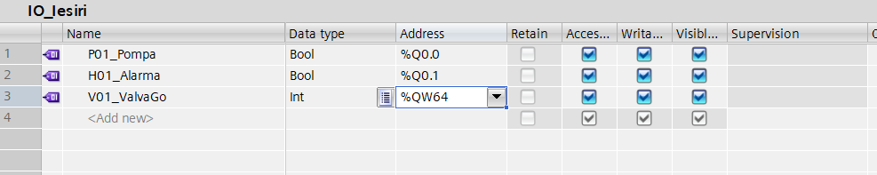

**Parametri** — `DB_Parametri`, editabili din HMI

| Variabilă | Tip | Valoare inițială | Rol |
|---|---|---|---|
| `Nivel_ScalaMin` | `Real` | `0.0` | Capătul inferior al scalei |
| `Nivel_ScalaMax` | `Real` | `100.0` | Capătul superior al scalei |
| `Nivel_PragPornire` | `Real` | `20.0` | Sub acest nivel pompa pornește |
| `Nivel_PragOprire` | `Real` | `80.0` | La acest nivel pompa se oprește |
| `Nivel_AlarmaMin` | `Real` | `5.0` | Prag alarmă nivel scăzut |
| `Nivel_AlarmaMax` | `Real` | `95.0` | Prag alarmă nivel ridicat |
| `Valva_Deschidere` | `Real` | `0.0` | Deschiderea valvei cerută de operator |

**Alocarea biților din `AlarmeWord`**

| Bit | Alarmă | Comportament |
|---|---|---|
| 0 | Senzor de nivel defect — semnal în afara domeniului | latch-uită, cere confirmare |
| 1 | Nivel scăzut | urmărește nivelul |
| 2 | Nivel ridicat | urmărește nivelul, declanșează golirea forțată |
| 3…15 | Rezervat | — |

### Cum funcționează

**Conversia.** Modulul de intrări analogice reprezintă domeniul 4–20 mA pe scala fixă Siemens `0…27648`. `NORM_X` aduce valoarea brută la `0.0…1.0`, iar `SCALE_X` o întinde pe domeniul dorit — aici procente. Cei doi pași sunt separați intenționat: capetele scalei modulului sunt constante scrise în cod, pentru că țin de hardware; capetele scalei de proces vin din `DB_Parametri`, pentru că țin de rezervor. Schimbi rezervorul, modifici doi parametri din HMI, iar codul rămâne neatins.

**Validarea semnalului.** Un senzor analogic defect continuă să furnizeze un număr, care arată perfect plauzibil pentru program. Fără verificare, un traductor blocat la 10 % ar face pompa să umple la nesfârșit. `FB_Alarme_Nivel` verifică o bandă de plauzibilitate pe valoarea brută — sub `-100` sau peste `28000` înseamnă defect, indiferent dacă e vorba de fir rupt, scurtcircuit sau valoarea de eroare scrisă de modul. O bandă acoperă toate cazurile deodată, spre deosebire de o comparație cu o valoare anume. Marjele față de capetele teoretice evită alarmele false la limita domeniului.

**Avarie și condiție de proces.** Defectul de senzor este latch-uit și cere confirmare: un fir care face contact intermitent ar produce altfel o alarmă care clipește și pe care nimeni nu o observă. Alarmele de nivel, în schimb, nu sunt latch-uite — un nivel scăzut este o stare normală a procesului, care dispare singură. Mai mult, alarmele de nivel se evaluează numai când măsurătoarea este validă: nu are sens să raportezi un nivel scăzut pe baza unui semnal în care nu ai încredere.

**Histerezisul.** Cu un singur prag, pompa ar porni și s-ar opri de zeci de ori pe minut în jurul lui, depășind cu mult numărul de porniri pe oră admis de motor și uzând contactorul. Cu două praguri, între 20 % și 80 % starea se memorează. Rețeaua folosește două comparatoare `<` și o ramură de auto-menținere; condiția de oprire „nivel ≥ 80 %" este exprimată direct ca negația ei, „nivel < 80 %", fără un `NOT` suplimentar.

**Interblocajul.** Fără măsurătoare validă, regimul automat nu comandă pompa. Regimul manual rămâne disponibil pentru intervenție — de exemplu, pentru golirea rezervorului tocmai când senzorul e defect — iar răspunderea trece la operatorul care vede rezervorul. Este o decizie de proiectare: pe un proces unde revărsarea este periculoasă s-ar bloca și manualul.

**Valva proporțională.** Trei rețele scriu succesiv în aceeași variabilă, iar ultima care se execută câștigă. Cazul normal preia comanda operatorului; un senzor defect o suprascrie cu `0 %`; nivelul ridicat suprascrie totul cu `100 %`, golire forțată. Ierarhia de prioritate este dată exclusiv de ordinea rețelelor. Rezultatul trece apoi prin `LIMIT 0…100`, pentru că orice valoare venită din afara programului — aici din HMI — trebuie limitată înainte de a fi folosită. Conversia finală spre modulul de ieșire este inversul celei de la intrare: `NORM_X` pe procente, `SCALE_X` spre `0…27648` ca `Int`.

**Numere reale.** Toate comparațiile pe valori analogice folosesc `<` sau `>`, niciodată `==`. Un `Real` nu poate reprezenta exact majoritatea zecimalelor, iar `50.0` obținut după două conversii poate fi `49.999996`.

### Panoul de operator (HMI)

**Sinoptic** — nivelul în timp real, pe bargraf cu marcaje la pragurile de histerezis, lămpi pentru pompă, cererea de umplere și validitatea măsurătorii, plus curba de tendință a nivelului.

Curba de tendință este elementul care face diferența pe un ecran de proces analogic: operatorul vede dintr-o privire dacă nivelul urcă, coboară sau oscilează, informație pe care o valoare numerică nu o conține.

**Parametri** — pragurile de histerezis și de alarmă, editabile. Sunt singurele câmpuri de scriere, alături de comanda valvei.

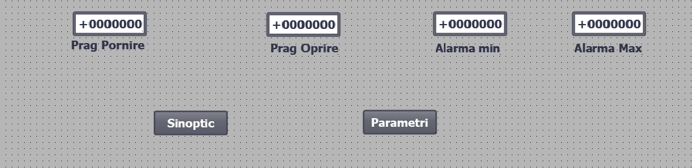

**Alarme** — configurate ca `Discrete alarms` pe cuvântul `AlarmeWord`, câte un bit per alarmă. Clasele diferă intenționat: defectul de senzor și nivelul ridicat sunt `Errors`, nivelul scăzut este `Warnings`.

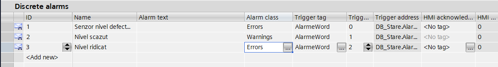

Principiul respectat: **zero logică în HMI**. Panoul citește și scrie variabile, nimic altceva. Limitarea valorii pentru valvă se face în PLC, nu în câmpul de pe ecran.

### Logica programului

**`FB_Nivel`** — conversia intrării

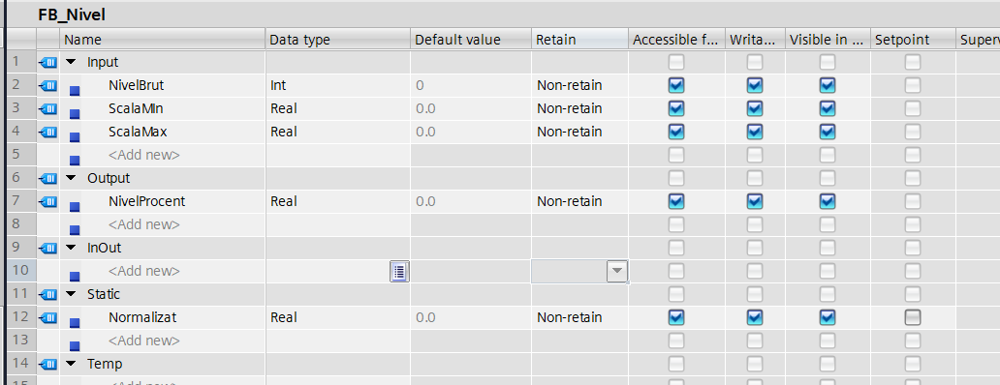
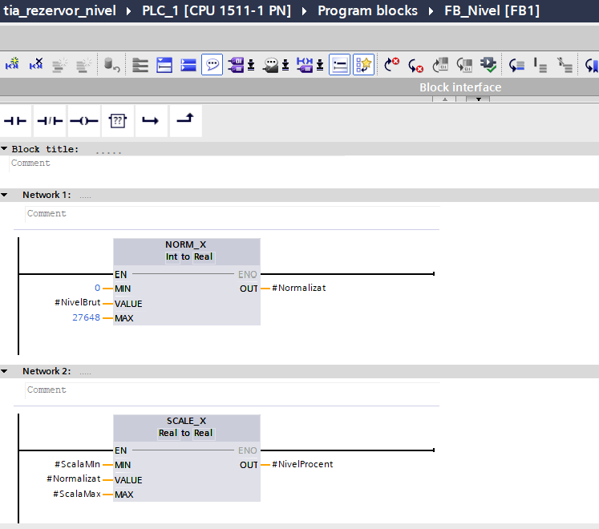

**`FB_Alarme_Nivel`** — validare și alarme

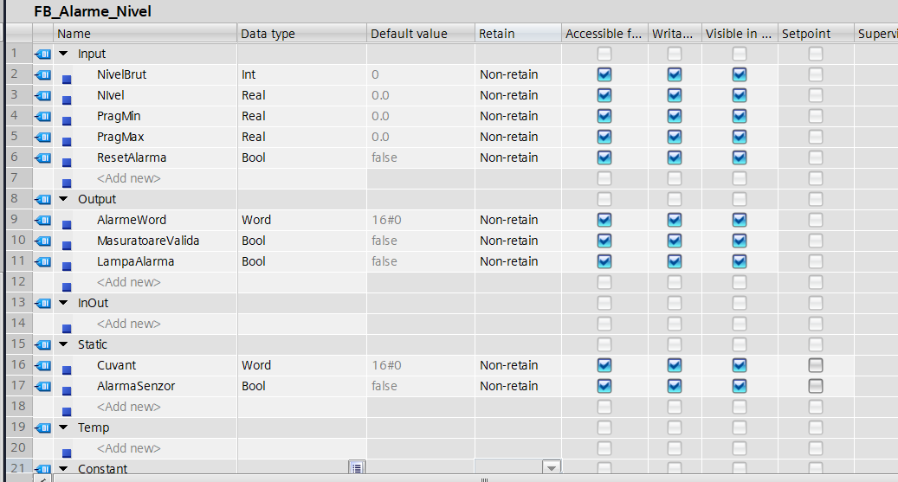
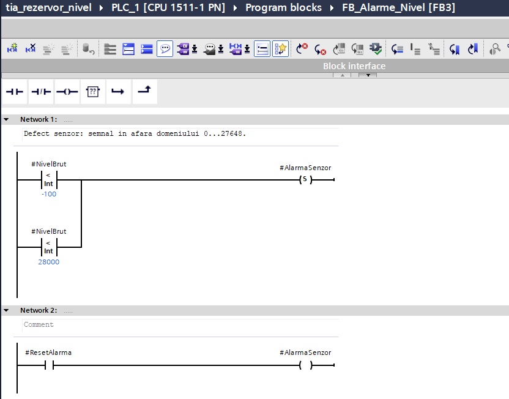
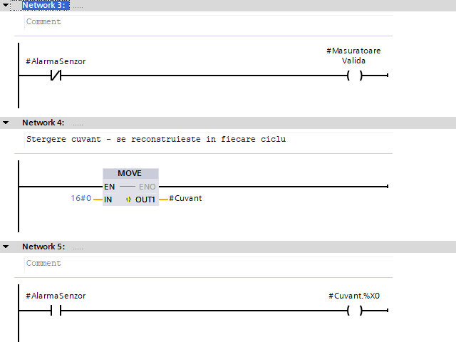
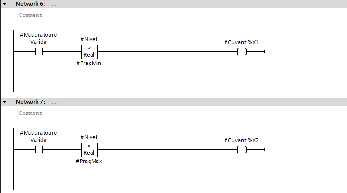
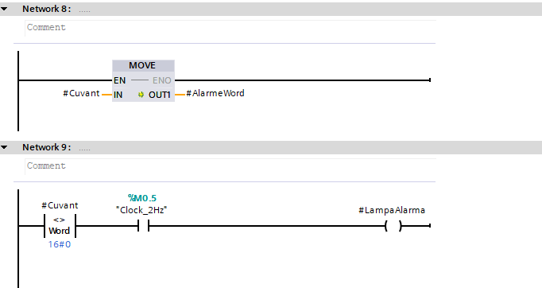

**`FB_Pompa`** — histerezis și regim de operare

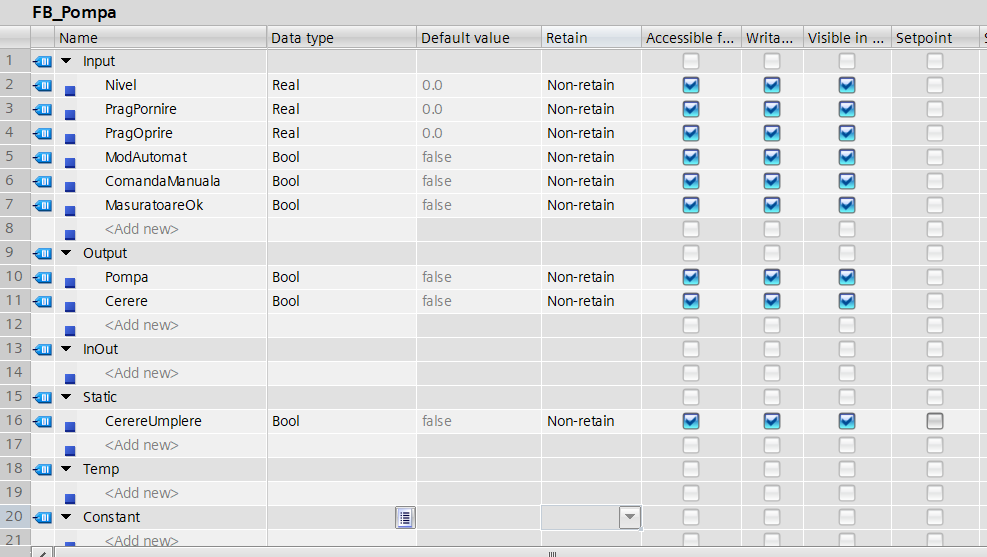
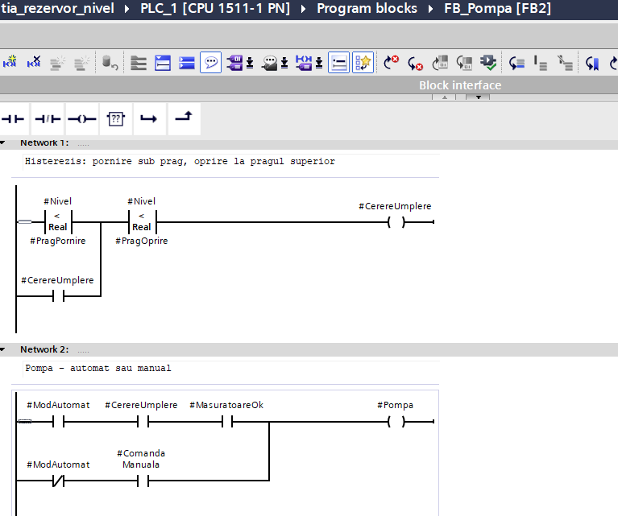
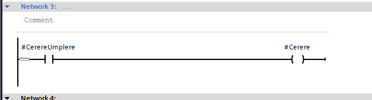

**`FB_Valva`** — priorități, limitare și conversia ieșirii

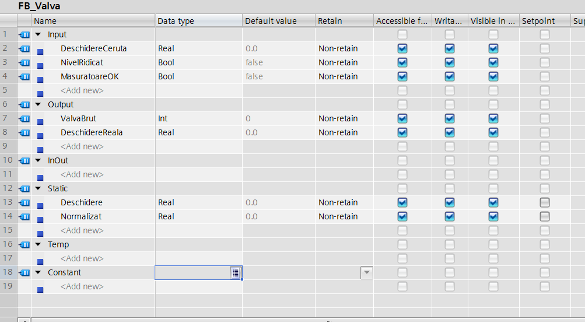
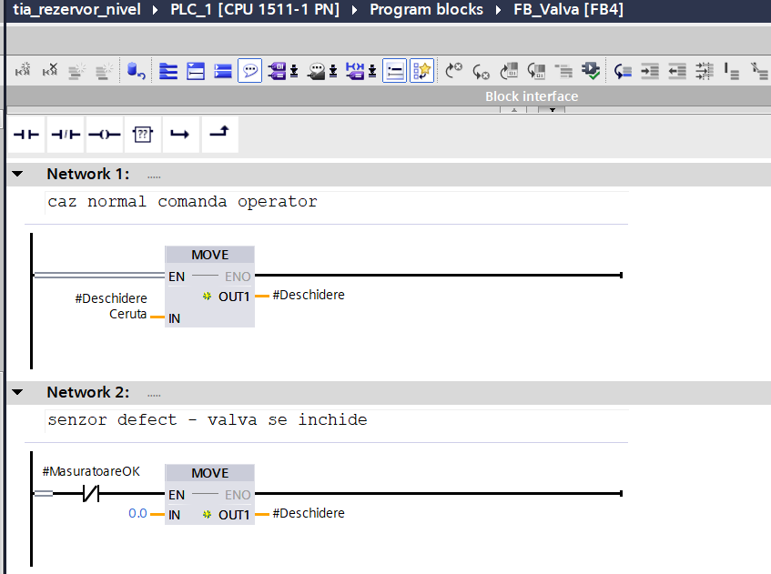
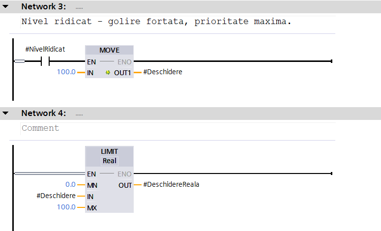
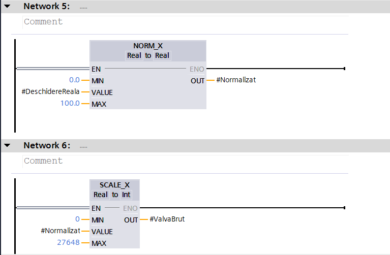

**`Main [OB1]`** — asamblarea

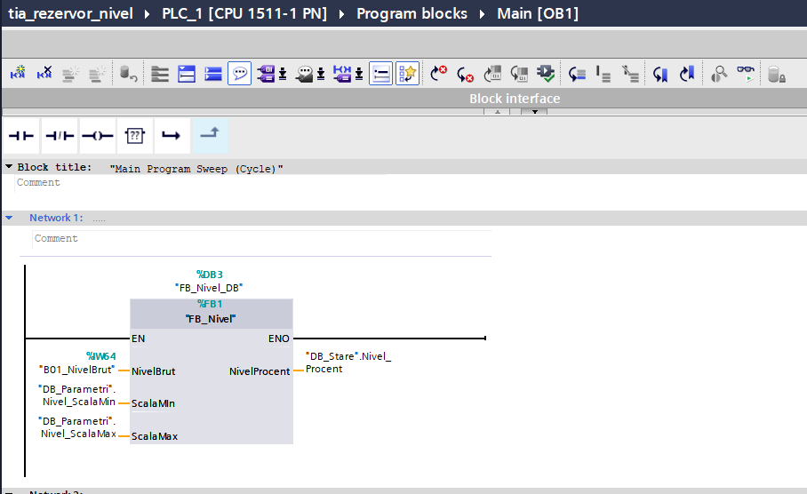
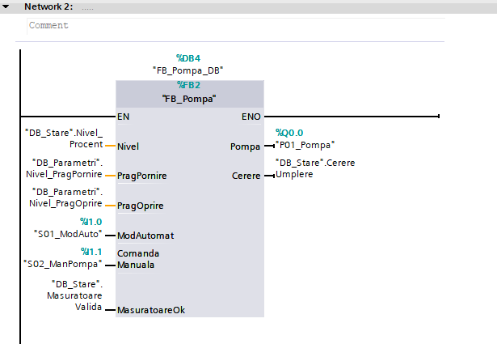
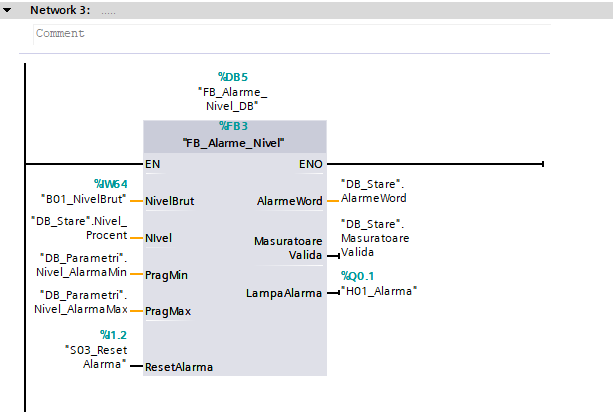
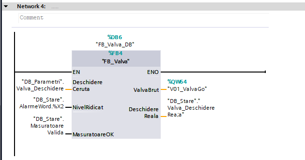

### Concepte demonstrate

- Configurare hardware completă: CPU, module digitale și analogice, parametrizarea canalelor, filtrare și diagnoză în modul
- Spațiu de adrese organizat pe benzi: digitale de la 0, analogice de la 64
- Conversia valoare brută ↔ unități inginerești cu `NORM_X` și `SCALE_X`, în ambele sensuri
- Validarea semnalului analogic printr-o bandă de plauzibilitate și interblocarea regimului automat pe validitate
- Distincția între avarie (latch, confirmare) și condiție de proces (urmărește procesul)
- Histerezis cu două praguri, exprimat cu comparatoare directe
- Comparații pe `Real` exclusiv cu operatori de inegalitate
- Ierarhie de prioritate prin ordinea rețelelor care scriu în aceeași variabilă
- Limitarea oricărei valori care vine din afara programului
- Alarme pe biți într-un cuvânt de stare, cu clase diferite
- Bargraf cu limite configurate declarativ și curbă de tendință pe HMI

### Stare curentă și limitări

Proiectul a fost scris și compilat, dar **nu a fost rulat**. Simulatorul S7-PLCSIM se descarcă separat de TIA Portal și este supus controlului de export; autorizarea nu a fost obținută. Validarea comportamentului rămâne de făcut.

### Cum se rulează

1. Deschide proiectul în TIA Portal V20 sau mai nou, cu STEP 7 Professional.
2. Compilează: click dreapta pe `PLC_1` → `Compile` → `Hardware and software (only changes)`.
3. Pentru simulare este necesar S7-PLCSIM, instalat separat: selectează `PLC_1` → `Start simulation` → `Load`.
4. Simulează nivelul scriind valori în `B01_NivelBrut` dintr-un `Watch and force table`: `0` = rezervor gol, `13824` = jumătate, `27648` = plin, `-500` sau `30000` = senzor defect.
5. Pentru panou: selectează `HMI_RT_1` → `Start simulation`.

### Realizat cu

- TIA Portal V20, STEP 7 Professional
- SIMATIC S7-1500, CPU 1511-1 PN, cu module AI, AQ, DI și DQ din seria ST/HF
- WinCC RT Advanced V20
- Limbaj: Ladder (LAD), conform IEC 61131-3

---

## 🇬🇧 English

- [Overview](#overview)
- [Signal chain](#signal-chain)
- [Hardware configuration](#hardware-configuration)
- [Program architecture](#program-architecture)
- [Variables (I/O)](#variables-io)
- [How it works](#how-it-works)
- [Operator panel (HMI)](#operator-panel-hmi)
- [Program logic](#program-logic)
- [Concepts demonstrated](#concepts-demonstrated)
- [Current state and limitations](#current-state-and-limitations)
- [How to run](#how-to-run)
- [Built with](#built-with)

### Overview

Control system for a tank with analog level measurement, implemented in Ladder (LAD) for SIMATIC S7-1500, with an operator panel in WinCC RT Advanced.

A 4–20 mA level transmitter is read through an analog input module and converted to percent. From the level, the program drives a fill pump with hysteresis between two thresholds, checks the signal for plausibility, raises level alarms, and drives a proportional drain valve through an analog output module.

The project complements the bottling line in the same portfolio, which worked purely with digital signals. The focus here is on what an analog signal adds: converting between raw value and engineering units in both directions, comparing real numbers, hysteresis, and above all the fact that a measurement has to be validated before it is acted upon.

### Signal chain

### Hardware configuration

| Slot | Module | Article | Addresses |
|---|---|---|---|
| 1 | CPU 1511-1 PN | `6ES7 511-1AL03-0AB0` | — |
| 2 | AI 8xU/I/RTD/TC ST | `6ES7 531-7KF00-0AB0` | `%IW64…%IW78` |
| 3 | DI 16x24VDC HF | `6ES7 521-1BH00-0AB0` | `%I0.0…%I1.7` |
| 4 | DQ 16x24VDC/0.5A HF | `6ES7 522-1BH00-0AB0` | `%Q0.0…%Q1.7` |
| 5 | AQ 4xU/I ST | `6ES7 532-5HD00-0AB0` | `%QW64…%QW70` |

Channel 0 of the analog input module is manually parameterised as `Current (2-wire transducer)`, range `4..20 mA`, with `Weak` smoothing and wire-break diagnostics enabled. Signal smoothing is therefore done in hardware, without a single line of code.

Analog addresses deliberately start at 64, apart from the digital ones. Anyone reading an address on a wiring diagram or a diagnostic report knows at once what kind of signal it is, without opening the configuration.

### Program architecture

Four function blocks, called from `Main [OB1]` in an order dictated by the data flow.

| Block | Role |
|---|---|
| `FB_Nivel` [FB1] | Converts the raw transmitter value to percent |
| `FB_Alarme_Nivel` [FB3] | Validates the signal, detects sensor faults, raises level alarms |
| `FB_Pompa` [FB2] | Drives the pump with hysteresis, in automatic or manual mode |
| `FB_Valva` [FB4] | Drives the proportional valve, with safety priorities and clamping |

The call order is `FB_Nivel` → `FB_Alarme_Nivel` → `FB_Pompa` → `FB_Valva`. The pump needs the level and the validation computed in the same cycle, and the valve needs the high-level alarm.

Two global data blocks keep settings and results apart:

| DB | Written by | Read by | Contents |
|---|---|---|---|
| `DB_Parametri` [DB1] | HMI | PLC | Scale, hysteresis and alarm thresholds, valve opening — all `Retain` |
| `DB_Stare` [DB2] | PLC | HMI | Level in percent, fill request, alarm word, measurement validity |

### Variables (I/O)

**Inputs**

| Variable | Type | Address | Role |
|---|---|---|---|
| `B01_NivelBrut` | `Int` | `%IW64` | Level transmitter, raw value |
| `S01_ModAuto` | `Bool` | `%I1.0` | Mode selector: 1 = automatic |
| `S02_ManPompa` | `Bool` | `%I1.1` | Manual pump command |
| `S03_ResetAlarma` | `Bool` | `%I1.2` | Alarm acknowledge |
| `Clock_2Hz` | `Bool` | `%M0.5` | CPU clock bit, drives the flashing lamp |

**Outputs**

| Variable | Type | Address | Role |
|---|---|---|---|
| `P01_Pompa` | `Bool` | `%Q0.0` | Fill pump contactor |
| `H01_Alarma` | `Bool` | `%Q0.1` | Alarm lamp, flashing |
| `V01_ValvaGolire` | `Int` | `%QW64` | Proportional drain valve, raw value |

**Parameters** — `DB_Parametri`, editable from the HMI

| Variable | Type | Start value | Role |
|---|---|---|---|
| `Nivel_ScalaMin` | `Real` | `0.0` | Lower end of the scale |
| `Nivel_ScalaMax` | `Real` | `100.0` | Upper end of the scale |
| `Nivel_PragPornire` | `Real` | `20.0` | Pump starts below this level |
| `Nivel_PragOprire` | `Real` | `80.0` | Pump stops at this level |
| `Nivel_AlarmaMin` | `Real` | `5.0` | Low-level alarm threshold |
| `Nivel_AlarmaMax` | `Real` | `95.0` | High-level alarm threshold |
| `Valva_Deschidere` | `Real` | `0.0` | Valve opening requested by the operator |

**`AlarmeWord` bit allocation**

| Bit | Alarm | Behaviour |
|---|---|---|
| 0 | Level sensor fault — signal out of range | latched, needs acknowledge |
| 1 | Low level | follows the level |
| 2 | High level | follows the level, triggers forced draining |
| 3…15 | Reserved | — |

### How it works

**Conversion.** The analog input module maps the 4–20 mA range onto Siemens' fixed `0…27648` scale. `NORM_X` brings the raw value to `0.0…1.0`, and `SCALE_X` stretches it over the desired range — percent here. The two steps are deliberately separate: the module's scale ends are constants in the code, because they belong to the hardware; the process scale ends come from `DB_Parametri`, because they belong to the tank. Change the tank, adjust two parameters from the HMI, and the code stays untouched.

**Signal validation.** A failed analog sensor keeps delivering a number, and that number looks perfectly plausible to the program. Without a check, a transmitter stuck at 10 % would make the pump fill forever. `FB_Alarme_Nivel` checks a plausibility band on the raw value — below `-100` or above `28000` means a fault, whether it is a broken wire, a short circuit or the error value written by the module. A band covers every case at once, unlike a comparison against one specific value. The margins from the theoretical ends avoid false alarms at the edge of the range.

**Fault versus process condition.** The sensor fault is latched and needs acknowledging: a wire making intermittent contact would otherwise produce a flickering alarm that nobody notices. The level alarms, by contrast, are not latched — a low level is a normal process state that clears by itself. Moreover, the level alarms are only evaluated while the measurement is valid: there is no point reporting a low level from a signal you do not trust.

**Hysteresis.** With a single threshold, the pump would start and stop dozens of times a minute around it, far exceeding the motor's permitted starts per hour and wearing out the contactor. With two thresholds, the state is held between 20 % and 80 %. The rung uses two `<` comparators and a seal-in branch; the stop condition "level ≥ 80 %" is expressed directly as its negation, "level < 80 %", without an extra `NOT`.

**Interlock.** Without a valid measurement, automatic mode does not drive the pump. Manual mode stays available for intervention — for instance, to drain the tank precisely when the sensor has failed — and responsibility passes to the operator who can see the tank. This is a design decision: on a process where overflow is dangerous, manual would be blocked too.

**Proportional valve.** Three rungs write in turn to the same variable, and the last one executed wins. The normal case takes the operator's command; a sensor fault overrides it with `0 %`; a high level overrides everything with `100 %`, forced draining. The priority ranking is set purely by rung order. The result then goes through `LIMIT 0…100`, because any value arriving from outside the program — here, from the HMI — must be clamped before it is used. The final conversion to the output module is the inverse of the input side: `NORM_X` on percent, `SCALE_X` to `0…27648` as `Int`.

**Real numbers.** All comparisons on analog values use `<` or `>`, never `==`. A `Real` cannot represent most decimals exactly, and a `50.0` obtained after two conversions may well be `49.999996`.

### Operator panel (HMI)

**Synoptic** — live level on a bar graph with markers at the hysteresis thresholds, lamps for the pump, the fill request and measurement validity, plus a trend curve of the level.

The trend curve is what makes the difference on an analog process screen: the operator sees at a glance whether the level is rising, falling or oscillating — information a single numeric value does not carry.

**Parameters** — the hysteresis and alarm thresholds, editable. Together with the valve command, these are the only write fields.

**Alarms** — configured as `Discrete alarms` on the `AlarmeWord` word, one bit per alarm. Classes differ on purpose: sensor fault and high level are `Errors`, low level is `Warnings`.

The principle held throughout: **no logic in the HMI**. The panel reads and writes variables, nothing more. Clamping of the valve value happens in the PLC, not in the screen field.

### Program logic

**`FB_Nivel`** — input conversion

**`FB_Alarme_Nivel`** — validation and alarms

**`FB_Pompa`** — hysteresis and operating mode

**`FB_Valva`** — priorities, clamping and output conversion

**`Main [OB1]`** — assembly

### Concepts demonstrated

- Complete hardware configuration: CPU, digital and analog modules, channel parameterisation, in-module filtering and diagnostics
- Address space organised in bands: digital from 0, analog from 64
- Raw ↔ engineering-unit conversion with `NORM_X` and `SCALE_X`, in both directions
- Analog signal validation through a plausibility band, with automatic mode interlocked on validity
- The distinction between a fault (latched, acknowledged) and a process condition (follows the process)
- Two-threshold hysteresis, expressed with direct comparators
- Comparisons on `Real` using inequality operators only
- Priority ranking through the order of rungs writing to the same variable
- Clamping of every value that comes from outside the program
- Bit-mapped alarms in a status word, with different alarm classes
- Bar graph with declaratively configured limits and a trend curve on the HMI

### Current state and limitations

The project was written and compiled, but **never executed**. The S7-PLCSIM simulator downloads separately from TIA Portal and is export-controlled; the authorisation was not obtained. Behavioural validation remains to be done.

### How to run

1. Open the project in TIA Portal V20 or newer, with STEP 7 Professional.
2. Compile: right-click `PLC_1` → `Compile` → `Hardware and software (only changes)`.
3. Simulation requires S7-PLCSIM, installed separately: select `PLC_1` → `Start simulation` → `Load`.
4. Simulate the level by writing to `B01_NivelBrut` from a `Watch and force table`: `0` = empty tank, `13824` = half, `27648` = full, `-500` or `30000` = sensor fault.
5. For the panel: select `HMI_RT_1` → `Start simulation`.

### Built with

- TIA Portal V20, STEP 7 Professional
- SIMATIC S7-1500, CPU 1511-1 PN, with ST/HF series AI, AQ, DI and DQ modules
- WinCC RT Advanced V20
- Language: Ladder (LAD), per IEC 61131-3
